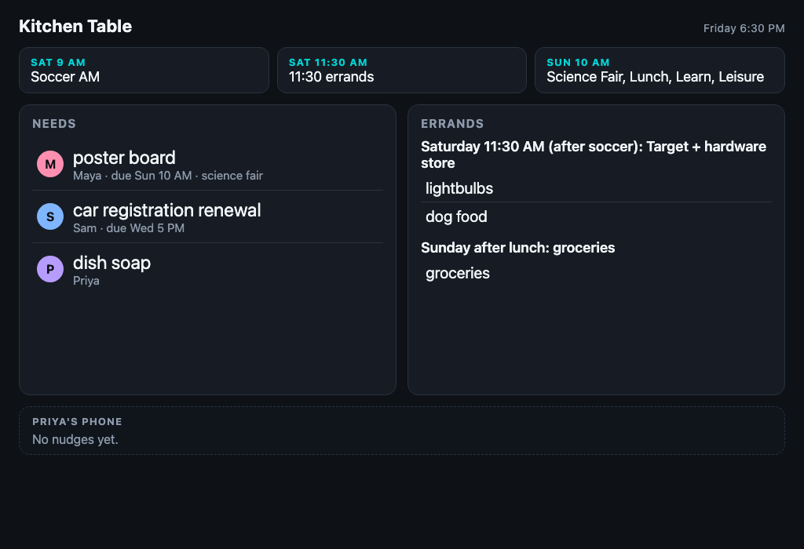
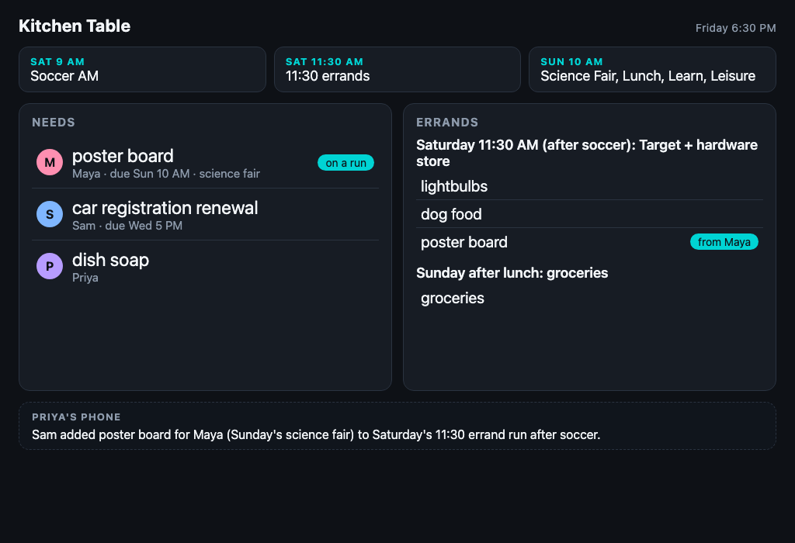

# Kitchen Table

One Alexa+ helper for the whole household. It remembers what each person needs, across days and across people, follows up on its own, and confirms before acting.

Built for the Alexa+ track of the Amazon Developer Hackathon "Build, Ship, Shape". An MCP server on Cloudflare Workers with a Durable Object per household, plus an MCP Apps board card.

**Watch (2 minutes):** https://youtu.be/vGV_YJFv-p8 · **Live board:** https://kitchen-table-mcp.wolfejam2020.workers.dev/demo · **Judges' testing steps:** [TESTING.md](TESTING.md)

| Before | After Sam says yes |
| :--- | :--- |
|  |  |

## The story it satisfies
1. **Thursday, Maya (10):** "Tell Kitchen Table I need poster board for the science fair on Sunday."
2. **Friday evening, Sam:** "Ask Kitchen Table if there's anything I should know." → "Soccer AM is at 9 AM tomorrow. One more thing: Maya needs poster board for Sunday's science fair. Want me to add it to the 11:30 errand run after soccer?"
3. **Sam:** "Yes." Nothing is written until this confirmation, in its own turn.
4. The card updates; the errand list shows poster board "from Maya".
5. Priya gets a nudge: "Sam added poster board for Maya (Sunday's science fair) to Saturday's 11:30 errand run after soccer."

No purchases are made.

### Deed of the week (the opposite of a timeout)
The board names the household member who did the most for someone else this week: "★ Deed of the week · **Sam** — got Maya's poster board on the run". It is awarded by the server, never claimed or voted on:
- No tool gives or claims a deed (a test checks the tool list).
- Only helping someone else's need counts, so scheduling your own earns nothing.
- One credit per need, so the same need cannot be farmed, and a repeat confirm adds nothing.
- The last 7 days count; most deeds wins; a tie goes to whoever reached the count first.

Limit: `speaker` is simulated in this build, so someone could pass another person's name. With real Alexa voice identification the same rules would hold per person.

## Architecture
```
Alexa+ (voice simulated in the demo) ─▶ an MCP client
                                          │ MCP Streamable HTTP  POST /mcp
                                          ▼
                       Cloudflare Worker  src/index.ts
                         ├─ MCP JSON-RPC (src/mcp.ts)
                         ├─ Durable Object "Household" (src/household.ts, SQLite-backed)
                         ├─ domain + six tools (src/domain.ts)
                         ├─ ui://kitchen-table/board card (src/card.ts)
                         └─ /demo, /demo/state, /demo/log, /admin/reset
```
No LLM calls inside tools. Every call logs `duration_ms`; tool-side latency is typically about 25 to 30 ms against the 500 ms Alexa+ limit; an occasional call takes a few hundred ms, and all stay under 500 ms. This build has not been run through a real Alexa+ account or device.

## Tools
| Tool | What it does | Writes? |
|---|---|---|
| `add_need` | Remember something a member needs, with an optional due date | yes (own list) |
| `whats_new_for_me` | Brief the speaker on others' open needs; offers one yes/no suggestion | marks items heard |
| `list_errands` | Upcoming errand runs and what's on each (max 5) | no |
| `propose_add_to_errand` | Preview adding a need to a run | no |
| `confirm_proposal` | Carry out a confirmed proposal and nudge the other parent | yes |
| `mark_done` | Mark a need handled | yes |

Every result has `structuredContent` plus a speakable `content[].text`. Errors are `isError: true` with a short spoken message. Card tools also return `_meta.ui.resourceUri = ui://kitchen-table/board`.

`confirm_proposal` refuses to act within 1 s of the question it answers ("Let me check with you first."), so an agent can't ask and confirm in one turn. `turn_gap_ms` is logged.

**For judges:** see [TESTING.md](TESTING.md) for a 1-minute, a 5-minute and a test-suite way to check it.

## Run locally
```bash
npm install
cp .dev.vars.example .dev.vars     # set MCP_TOKEN and ADMIN_SECRET
npm run dev                         # http://127.0.0.1:8787
npm test                            # starts wrangler dev itself and calls the live /mcp
```
- Board: `http://127.0.0.1:8787/demo`
- Inspector: `npx @modelcontextprotocol/inspector` → Streamable HTTP → `http://127.0.0.1:8787/mcp`, header `Authorization: Bearer <MCP_TOKEN>`
- Reset between takes: `curl -X POST -H "x-admin-secret: $ADMIN_SECRET" localhost:8787/admin/reset` (demo clock). Body `{"now":null}` uses the real clock; `{"now":"<ISO>"}` pins a time.

## Demo clock
The seed is relative to a pinned clock, **Fri 2026-10-23 6:30 PM ET**, so "tomorrow" is Saturday whenever you record. Dates resolve in America/New_York.

## Deploy
```bash
npx wrangler secret put MCP_TOKEN
npx wrangler secret put ADMIN_SECRET
npx wrangler deploy
```
Deployed at https://kitchen-table-mcp.wolfejam2020.workers.dev. `addon.json` points at it; only the icon and carousel image URLs are still placeholders (assets not made yet).

## Connecting a client
Any MCP client that speaks Streamable HTTP can use `https://<worker-host>/mcp` with `Authorization: Bearer <token>`. The [alexa-skill-mcp-bridge](https://github.com/KayLerch/alexa-skill-mcp-bridge) is a route to testing through Alexa; we did not run it for this entry (it needs an AWS account with Bedrock access, which was still being verified).

## Auth
- **Simple mode (implemented):** a static bearer token from a Worker secret. Demo only.
- **Unauthenticated `/mcp` returns HTTP 401 with no `WWW-Authenticate` header**, as the Alexa+ quickstart requires. There is a test.
- **OAuth 2.1 + PKCE S256 (not implemented):** the Alexa+ quickstart requires it for real account linking. The hackathon rules ask for a self-hosted MCP server on spec 2025-11-25 over Streamable HTTP, which this is, but this build cannot be linked to a real Alexa+ account. The Worker serves no OAuth endpoints.
- **Speaker identity is simulated.** `speaker` is whatever the caller passes. Real Alexa+ voice ID is out of scope, and `speaker` is not an authentication boundary.

## Limitations
- One fictional household (`hh_patel`), seeded data, seeded calendar (not a live calendar).
- No purchases, ever.
- The MCP Apps card follows the MCP Apps convention (`text/html;profile=mcp-app`, postMessage tool-result) but the quickstart doesn't document the Alexa+ rendering contract. *Unverified.*
- Email is not sent. Nudges go to Priya's inbox view on `/demo`, and to `NOTIFY_WEBHOOK_URL` if you set it.

## What's new since Aug 31
The whole project.

## AI tools used
- **Claude Code:** wrote the server, tests, board card, docs, deploy scripts, the demo helper and the video tooling.
- **Grok Voice:** the synthetic voices in the video: the narrator, Maya, Sam and Alexa. Labelled as simulated on screen.
- **Kiro CLI:** a read-only review of the code and two regression tests it wrote (Accept negotiation, notification 202 with an empty body). Sign-in only worked late on the last night (see the friction log). Its review findings were checked and none was a defect.
- **Kiro Crew:** installed and used for a stranger test of this repo (a fresh clone, then `TESTING.md` followed step by step: 26 of 26 tests passed) and for one suggested test, which we discarded as a duplicate of an existing test.
- **Not used:** Amazon Bedrock, AgentCore, Strands and Nova. The server makes no model calls at runtime.

## Links
Live: https://kitchen-table-mcp.wolfejam2020.workers.dev/demo · Video: https://youtu.be/vGV_YJFv-p8 · [Friction log](FRICTION_LOG.md)

## License
MIT
